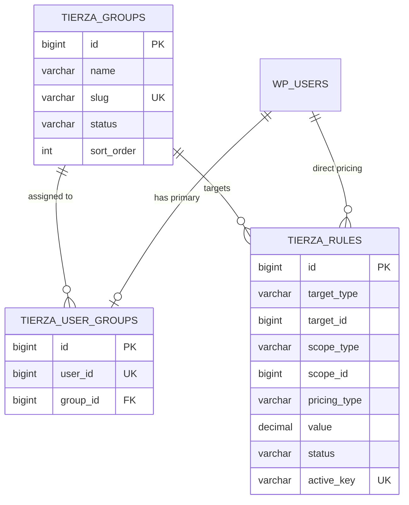

# Tierza Database Schema & Persistence Architecture

**Document Version:** 1.0.0  
**Schema Version:** `1.0.0` (`tierza_db_version`)  
**Target Environments:** MySQL 5.7+, MySQL 8.0+, MariaDB 10.4+  
**Architecture Layer:** Infrastructure & Domain Persistence

---

## 1. Overview & Architectural Principles

Tierza persists its configuration and business entities using dedicated, normalized database tables prefixed with WordPress's dynamic site prefix (`{$wpdb->prefix}`).

Key architectural rules:
1. **Never mutate WooCommerce core pricing tables destructively**: Tierza rules and tiers are stored in dedicated schema tables, leaving WooCommerce's `_regular_price` and `_sale_price` untouched.
2. **Deterministic Uniqueness**: Uniqueness constraints prevent logical collision in active pricing contexts without depending on proprietary database features.
3. **Persian & Unicode First**: Full UTF-8 (`utf8mb4`) support for Persian names and slugs. Group names are not restricted to ASCII.
4. **Authoritative Server Calculations**: All pricing values are stored with `DECIMAL(20,6)` precision, avoiding floating-point inaccuracy.
5. **Idempotent Migrations**: Database installations and upgrades use WordPress standard `dbDelta()` and can run repeatedly without modifying existing customer data or duplicating schema structures.
6. **Data Retention**: Tables and data are strictly preserved across plugin deactivation.

---

## 2. Table Definitions

### 2.1 Table A: `tierza_groups`

Stores customer wholesale and B2B pricing groups / tiers.

| Column | Data Type | Nullable | Default | Description |
| :--- | :--- | :---: | :--- | :--- |
| `id` | `BIGINT(20) UNSIGNED` | No | AUTO_INCREMENT | Unique primary key identifier. |
| `name` | `VARCHAR(190)` | No | | Display name of the group (Unicode/Persian supported). |
| `slug` | `VARCHAR(190)` | No | | Normalized URL/identifier slug. Must be unique. |
| `description` | `TEXT` | Yes | `NULL` | Optional description or internal notes. |
| `status` | `VARCHAR(20)` | No | `'active'` | Group status: `'active'` or `'inactive'`. |
| `sort_order` | `INT(11)` | No | `0` | UI display ordering / priority hint. |
| `created_at` | `DATETIME` | No | | Timestamp when record was created. |
| `updated_at` | `DATETIME` | No | | Timestamp when record was last updated. |

**Indexes & Constraints:**
- `PRIMARY KEY (id)`
- `UNIQUE KEY uq_slug (slug)`: Enforces unique slug across all groups.
- `KEY idx_status_sort (status, sort_order)`: Optimizes listing active groups ordered by priority.

```sql
CREATE TABLE {$wpdb->prefix}tierza_groups (
  id bigint(20) unsigned NOT NULL AUTO_INCREMENT,
  name varchar(190) NOT NULL,
  slug varchar(190) NOT NULL,
  description text NULL,
  status varchar(20) NOT NULL DEFAULT 'active',
  sort_order int(11) NOT NULL DEFAULT 0,
  created_at datetime NOT NULL,
  updated_at datetime NOT NULL,
  PRIMARY KEY  (id),
  UNIQUE KEY uq_slug (slug),
  KEY idx_status_sort (status, sort_order)
) {$charset_collate};
```

---

### 2.2 Table B: `tierza_rules`

Stores percentage-based or fixed pricing rules targeted to groups or specific users, applied across global, category, product, or variation scopes.

| Column | Data Type | Nullable | Default | Description |
| :--- | :--- | :---: | :--- | :--- |
| `id` | `BIGINT(20) UNSIGNED` | No | AUTO_INCREMENT | Unique primary key identifier. |
| `target_type` | `VARCHAR(20)` | No | | Target type: `'group'` or `'user'`. |
| `target_id` | `BIGINT(20) UNSIGNED` | No | | Target ID (pricing group ID or WordPress user ID). |
| `scope_type` | `VARCHAR(20)` | No | | Scope: `'global'`, `'category'`, `'product'`, `'variation'`. |
| `scope_id` | `BIGINT(20) UNSIGNED` | No | `0` | Scope entity ID (0 for global scope, specific ID for others). |
| `pricing_type` | `VARCHAR(20)` | No | | Pricing calculation type: `'percentage'` or `'fixed'`. |
| `value` | `DECIMAL(20,6)` | No | `0.000000` | Rule value: percentage (0–100) or fixed amount. |
| `status` | `VARCHAR(20)` | No | `'active'` | Rule status: `'active'` or `'inactive'`. |
| `active_key` | `VARCHAR(100)` | Yes | `NULL` | Atomic active rule uniqueness key (`target:id\|scope:id`). `NULL` for inactive rules. |
| `created_at` | `DATETIME` | No | | Timestamp when record was created. |
| `updated_at` | `DATETIME` | No | | Timestamp when record was last updated. |

**Indexes & Constraints:**
- `PRIMARY KEY (id)`
- `UNIQUE KEY uq_active_rule (active_key)`: Database-enforced atomic uniqueness preventing concurrent active rule duplicates.
- `KEY idx_target (target_type, target_id, status)`: Fast filtering for a given customer or group.
- `KEY idx_scope (scope_type, scope_id, status)`: Fast filtering by product, category, or global scope.
- `KEY idx_lookup (target_type, target_id, scope_type, scope_id, status)`: Composite index for resolution queries and active rule collision checks.

```sql
CREATE TABLE {$wpdb->prefix}tierza_rules (
  id bigint(20) unsigned NOT NULL AUTO_INCREMENT,
  target_type varchar(20) NOT NULL,
  target_id bigint(20) unsigned NOT NULL,
  scope_type varchar(20) NOT NULL,
  scope_id bigint(20) unsigned NOT NULL DEFAULT 0,
  pricing_type varchar(20) NOT NULL,
  value decimal(20,6) NOT NULL DEFAULT 0.000000,
  status varchar(20) NOT NULL DEFAULT 'active',
  active_key varchar(100) DEFAULT NULL,
  created_at datetime NOT NULL,
  updated_at datetime NOT NULL,
  PRIMARY KEY  (id),
  UNIQUE KEY uq_active_rule (active_key),
  KEY idx_target (target_type, target_id, status),
  KEY idx_scope (scope_type, scope_id, status),
  KEY idx_lookup (target_type, target_id, scope_type, scope_id, status)
) {$charset_collate};
```

---

### 2.3 Table C: `tierza_user_groups`

Maps WordPress user accounts to their primary Tierza pricing group.

| Column | Data Type | Nullable | Default | Description |
| :--- | :--- | :---: | :--- | :--- |
| `id` | `BIGINT(20) UNSIGNED` | No | AUTO_INCREMENT | Unique primary key identifier. |
| `user_id` | `BIGINT(20) UNSIGNED` | No | | WordPress user account ID (`wp_users.ID`). |
| `group_id` | `BIGINT(20) UNSIGNED` | No | | Assigned pricing group ID (`tierza_groups.id`). |
| `created_at` | `DATETIME` | No | | Timestamp when assignment was created. |
| `updated_at` | `DATETIME` | No | | Timestamp when assignment was last modified. |

**Indexes & Constraints:**
- `PRIMARY KEY (id)`
- `UNIQUE KEY uq_user_id (user_id)`: Enforces exactly **one primary group** per WordPress user in version 1.
- `KEY idx_group_id (group_id)`: Fast listing of all users assigned to a specific group.

```sql
CREATE TABLE {$wpdb->prefix}tierza_user_groups (
  id bigint(20) unsigned NOT NULL AUTO_INCREMENT,
  user_id bigint(20) unsigned NOT NULL,
  group_id bigint(20) unsigned NOT NULL,
  created_at datetime NOT NULL,
  updated_at datetime NOT NULL,
  PRIMARY KEY  (id),
  UNIQUE KEY uq_user_id (user_id),
  KEY idx_group_id (group_id)
) {$charset_collate};
```

---

## 3. Entity-Relationship Diagram



---

## 4. Uniqueness & Collision Policies

### 4.1 Group Slugs
- Slugs are sanitized and normalized using `GroupSlug` domain value object.
- Persian letters (`\p{L}`) and numbers (`\p{N}`) are preserved.
- Uniqueness is enforced both at the application layer (`WpGroupRepository::save`) and at the database layer (`UNIQUE KEY uq_slug`).

### 4.2 Active Pricing Rules Uniqueness & Concurrency Safety
- In Tierza v1, only **one active rule** may exist for any logical target and scope combination:
  $$\text{Logical Key} = \text{target\_type} + \text{target\_id} + \text{scope\_type} + \text{scope\_id}$$
- **Pricing Type is NOT part of the conflict identity**: An active percentage rule and an active fixed rule targeting the same entity and scope conflict immediately and cannot coexist.
- **Atomic Database-Level Enforcement (`active_key`)**:
  1. Standard MySQL / MariaDB storage engines treat `NULL` as distinct values under `UNIQUE` indexes (per SQL-92 standards).
  2. For active rules (`status = 'active'`), Tierza computes and persists `active_key` as:
     `sprintf('%s:%d|%s:%d', $target_type, $target_id, $scope_type, $scope_id)`
  3. For inactive rules (`status = 'inactive'`), `active_key` is set to `NULL`.
  4. The unique index `UNIQUE KEY uq_active_rule (active_key)` prevents race conditions and concurrent inserts from creating duplicate active rules, providing guaranteed atomicity without table locks.
  5. Multiple inactive historical rules may coexist indefinitely with `active_key = NULL`.
- **Application-Level Pre-Checks**:
  `WpRuleRepository::find_conflicting_active_rule()` checks for existing active rules before insertion or reactivation and throws a domain `DuplicateRuleException`.
- **Concurrency Fallback**:
  If concurrent requests pass the application check simultaneously, the database raises error `1062` (Duplicate entry for key `uq_active_rule`), which `WpRuleRepository` catches and wraps cleanly into `DuplicateRuleException`.

### 4.3 User Group Assignments
- In MVP, each WordPress customer is assigned to exactly **one primary pricing group**.
- Uniqueness is strictly guaranteed by `UNIQUE KEY uq_user_id (user_id)` in `tierza_user_groups`.
- Reassigning a customer uses atomic `update` on the existing user row.

---

## 5. Data Integrity, Reference Validation & Safeguards

### 5.1 Entity Reference Validation
Tierza performs real-time referential validation via `EntityReferenceValidator` before persisting rules or group assignments:
1. **User References**: Validates that `target_id` (or assignment `user_id`) exists in `{$wpdb->users}`.
2. **Group References**: Validates that `target_id` (or assignment `group_id`) exists in `{$wpdb->prefix}tierza_groups`.
3. **Product Scope**: Validates that `scope_id` exists in `{$wpdb->posts}` with `post_type = 'product'`.
4. **Variation Scope**: Validates that `scope_id` exists with `post_type = 'product_variation'` and links to a valid parent product.
5. **Category Scope**: Validates that `scope_id` exists in `{$wpdb->term_taxonomy}` with `taxonomy = 'product_cat'`.

Attempting to reference a non-existent entity raises `InvalidEntityReferenceException`.

### 5.2 Safeguards & Domain Constraints
1. **Group Deletion Safeguard**:
   A pricing group cannot be deleted while:
   - Users are assigned to it in `tierza_user_groups` (`GroupDeletionSafeguardException`).
   - Pricing rules target it in `tierza_rules` (`GroupDeletionSafeguardException`).
2. **Fixed-Price Scope Restriction**:
   In version 1.0, fixed prices are strictly restricted to `product` and `variation` scopes. Global or category-level fixed prices are rejected by `PricingRule`.
3. **Explicit Zero Preservation**:
   A rule with value `0` (such as 0% discount or 0.00 price) is validly persisted and distinct from a missing or deleted rule.
4. **Soft References**:
   To ensure maximum hosting compatibility without brittle foreign-key locks during table migration or WordPress backups, foreign relations are validated at the application/repository boundary.

---

## 6. Migration & Versioning Lifecycle

- Current schema version is stored in the WordPress `options` table under option key **`tierza_db_version`**.
- During plugin activation, `Schema::install()` is invoked.
- On each plugin boot (`plugins_loaded`), `Schema::maybe_upgrade()` performs a lightweight version check against `Schema::CURRENT_DB_VERSION`.
- If an update is required, `dbDelta()` applies idempotent DDL changes.
- **Failure-Safe Schema Verification**:
  1. Immediately following DDL execution, `Schema::verify_schema()` inspects the database to ensure all 3 tables exist, all expected columns are present, and essential unique keys (`uq_slug`, `uq_active_rule`, `uq_user_id`) exist.
  2. If any discrepancy is found, `SchemaMigrationException` is thrown, and `tierza_db_version` is **not updated**.
  3. Subsequent activations or admin loads can safely retry migration without data loss or partial state corruption.

---

## 7. Multisite Considerations

- In WordPress multisite networks, each subsite possesses its own isolated table prefix (e.g. `wp_2_tierza_groups`, `wp_3_tierza_groups`).
- `Schema::get_table_name()` retrieves the prefix dynamically via `$wpdb->prefix`.
- When switching blogs (`switch_to_blog()`), all repository operations automatically route to the active blog's schema tables.

---

## 8. Rollback & Recovery Strategy

- **Backup**: Always take a standard database backup before schema upgrades.
- **Rollback**: If a migration fails, the previous code version can be restored. Tierza schema changes are strictly additive and backward-compatible within the same major version.
- **Data Cleanup**: Uninstall routines (`uninstall.php`) are decoupled from deactivation. Tables are never dropped on deactivation.
