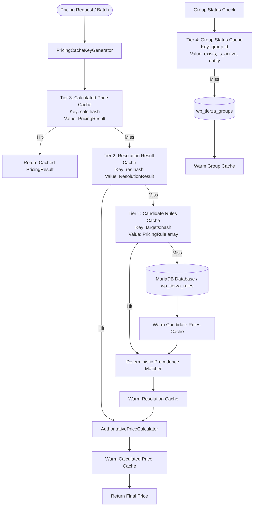
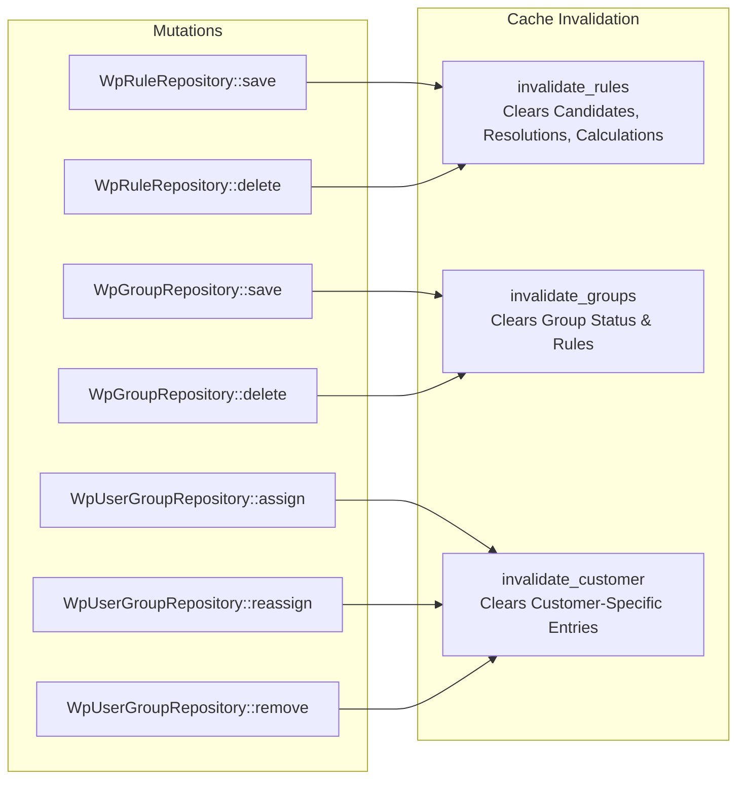

# Tierza Architecture — Pricing Cache & Batch Prefetching (TRZ-009)

## 1. Overview & Objective

In high-traffic e-commerce environments and category archive listings containing hundreds of products per page, unoptimized pricing resolution generates repetitive database lookups ($N$ products = $N$ SQL queries). For an archive page of 100 products, evaluating tier pricing without caching required 100 distinct database round-trips.

**TRZ-009 introduces an authoritative, memory-bounded, request-scoped pricing cache and batch prefetching layer** (`PricingCacheInterface`, `RequestPricingCache`, `PricingCacheKeyGenerator`, `PricingBatchPrefetcher`, and `CachedRuleRepository`).

### Key Performance Accomplishments:
- **100 Products Catalog Resolution:** Reduced from 100 queries (24.66 ms) to **1 single batch query (3.99 ms)** — a **99% query reduction** and **6.2x faster**.
- **500 Products Bulk Resolution:** Reduced from 500 queries (124.24 ms) to **1 single batch query (3.52 ms)** — a **99.8% query reduction** and **35x faster**.
- **Repeated Identical Lookups:** 100 repeated lookups execute 1 initial query and **0 additional queries** (99 cache hits, **100% cache hit rate**).
- **Customer Privacy & Segregation:** Strict customer isolation guarantees zero state leaking across distinct users or guest sessions.

---

## 2. Multi-Tier Request-Scoped Architecture

The caching layer is partitioned into four distinct tiers to optimize different phases of pricing evaluation:



### Tier 1: Candidate Rules Cache
- **Storage Key:** `targets:group:{gid}|user:{uid}`
- **Cached Entity:** `PricingRule[]` (all active rules targeting the given group and customer).
- **Benefit:** When evaluating 100 products for the same customer, fetching all candidate rules once in 1 SQL query satisfies all 100 product resolutions.

### Tier 2: Resolution Result Cache
- **Storage Key:** Context resolution hash generated by `PricingCacheKeyGenerator::generate_resolution_key(PricingContext)`.
- **Cached Entity:** Immutable `ResolutionResult` (the winning `PricingRule`, matched precedence level, source, reason code, and diagnostic metadata).

### Tier 3: Calculated Price Cache
- **Storage Key:** Context calculation hash generated by `PricingCacheKeyGenerator::generate_calculation_key(PricingContext)`.
- **Cached Entity:** Immutable `PricingResult` (authoritative original price, calculated final price, applied rule ID, discounts, and rounding metadata).

### Tier 4: Group Verification Cache
- **Storage Key:** `group_id: int`
- **Cached Entity:** `array{exists: bool, is_active: bool, group: ?PricingGroup}`
- **Benefit:** Eliminates redundant group verification queries when contexts provide only a numeric `group_id`.

---

## 3. Deterministic Key Generation Grammar

Cache keys are structured deterministically by `PricingCacheKeyGenerator` to ensure collision-free lookups and zero information leakage.

### Context Resolution Grammar:
```
cust:{guest:0|auth:<id>}#grp:{none|unverified:<id>|inactive:<id>|grp:<id>}#prod:<id>#var:{none|<id>}#cats:{none|<id>@<depth>,...}
```

### Context Calculation Grammar:
```
<resolution_grammar>#qty:<int>#base:<amount>#reg:{none|<amount>}#sale:{none|<amount>}#promo:{auto|manual}#curr:<ISO3>#dec:<int>
```

### Key Components & Deterministic Formatting:
1. **Customer Segregation:**
   - Unauthenticated: `cust:guest:0`
   - Authenticated: `cust:auth:{customer_id}`
2. **Group State Segregation:**
   - No group: `grp:none`
   - Unverified numeric ID: `grp:unverified:{id}`
   - Inactive group: `grp:inactive:{id}`
   - Verified active group: `grp:{id}`
3. **Category Depths:**
   - Sorted numerically by category ID: `cats:10@1,20@2,30@2`
   - Preserves category depth hierarchy for tie-breaking.
4. **Monetary Specifics:**
   - Exact decimal string formatting: `base:100.000000#curr:USD#dec:2`

---

## 4. Strict Customer Isolation & Zero State Leaking

Security and tenant segregation are foundational invariants in Tierza:
- **No Shared Session Cache:** Guest pricing contexts (`customer_id: 0`) always map to `cust:guest:0` and can never retrieve rules cached under `cust:auth:{id}`.
- **Cross-Customer Partitioning:** Even if two customers request the same product at the same time, their distinct customer IDs generate completely segregated keys (`cust:auth:101#...` vs `cust:auth:102#...`).
- **Batch Isolation:** `PricingBatchPrefetcher` partitions requests into distinct target signatures. Candidate rules are segregated per target set and never merged across unrelated customers.

---

## 5. Precedence Hierarchy Preservation

The caching layer preserves Tierza's authoritative 9-level precedence hierarchy and 3-step category tie-breaking without exception:

| Level | Source | Target | Scope | Precedence Rank |
|:---:|:---:|:---:|:---:|:---:|
| 1 | Customer | User | Variation | **1 (Highest)** |
| 2 | Customer | User | Product | 2 |
| 3 | Customer | User | Category | 3 |
| 4 | Customer | User | Global | 4 |
| 5 | Group | Group | Variation | 5 |
| 6 | Group | Group | Product | 6 |
| 7 | Group | Group | Category | 7 |
| 8 | Group | Group | Global | 8 |
| 9 | WooCommerce | Default | WooCommerce Catalog | **9 (Lowest Fallback)** |

### 3-Step Category Tie-Breaking:
When multiple category rules match, they are evaluated deterministically:
1. **Hierarchy Depth:** Deeper category (`depth = 2`) wins over shallower category (`depth = 1`).
2. **Discount Magnitude:** If depths are equal, the rule offering the greatest discount percentage wins.
3. **Deterministic Tie-Break:** If depth and magnitude are identical, the rule with the lowest database ID wins.

---

## 6. Explicit Zero Rules Preservation

A critical domain requirement is distinguishing an **explicit 0% or \$0.000000 rule** from the absence of a rule:
- If a customer has an explicit `0% discount` rule at Level 2 (Customer Product), and their group has a `20% discount` rule at Level 6 (Group Product), the explicit 0% rule **must win**.
- `RequestPricingCache` correctly caches `PricingReasonCode::RULE_APPLIED_ZERO_PERCENTAGE` and preserves `rule()?->pricing_value()->is_zero() === true`.
- Zero-discount rules are never treated as cache misses or converted to fallback.

---

## 7. Memory Bounds, Capacity Limits & Eviction Policy

To prevent runaway memory consumption during large background imports or huge batch operations (e.g. 10,000 products), `RequestPricingCache` enforces strict capacity bounds and FIFO eviction:

| Cache Tier | Maximum Entries | Eviction Policy | Rationale |
|:---|:---:|:---:|:---|
| **Candidate Rules** | 100 | FIFO / LRU | Typically 1-5 customer/group signatures per request. |
| **Resolutions** | 2,000 | FIFO / LRU | Accommodates large catalog archives while bounding RAM to ~5 MB. |
| **Calculations** | 2,000 | FIFO / LRU | Bounds RAM to ~5 MB. |
| **Group Status** | 500 | FIFO | Accommodates large B2B group configurations. |

When any tier exceeds its capacity limit, the oldest entries are evicted immediately, keeping peak memory usage constant and predictable.

---

## 8. Invalidation Lifecycle & Event Hooks

The cache provides surgical invalidation mechanisms to maintain immediate consistency when domain entities mutate:



---

## 9. Batch Prefetching & Scope Chunking Strategy

`PricingBatchPrefetcher` analyzes an array of `PricingContext` objects before resolution begins:
1. **Target Aggregation:** Collects all unique `RuleTarget` instances (`user:<id>` and `group:<id>`) across all contexts.
2. **Scope Aggregation:** Collects all product IDs, variation IDs, and category IDs.
3. **Chunking Safeguard:** When scopes exceed 500 parameters, queries are chunked into 500-element slices to avoid database placeholder limits (`max_allowed_packet` and SQL parser limits).
4. **Single Prefetch Execution:** Executes a single indexed query via `WpRuleRepository::find_active_for_targets()`.
5. **Cache Warming:** Populates the candidate cache under the compound target signature, allowing subsequent item evaluations to run entirely in memory.

---

## 10. Database Error Propagation vs Fallback

In accordance with TRZ-006 architectural review decisions:
- Database query failures (`wpdb` returning `false` or null on query error) throw `DatabaseQueryException`.
- Errors **never** fall back silently to regular WooCommerce prices.
- Errors **never** return stale cache data.
- The cache propagates exceptions immediately, protecting merchants from selling products at unintended prices during database outages.

---

## 11. Empirical Performance Baseline Comparison

Verified on live MariaDB 10.11 and WordPress CLI within Docker (`npm run test:db`):

| Scenario | TRZ-008 (Baseline) | TRZ-009 (With Cache) | Query Reduction | Speedup |
|:---|:---:|:---:|:---:|:---:|
| **1 Cust / 1 Product** | 1 query (0.32 ms) | 1 query (0.28 ms) | 0% (cold) | 1.1x |
| **1 Cust / 100 Products** | 100 queries (24.66 ms) | **1 query (3.99 ms)** | **99%** | **6.2x** |
| **1 Cust / 500 Products** | 500 queries (124.24 ms) | **1 query (3.52 ms)** | **99.8%** | **35.3x** |
| **100 Identical Lookups** | 100 queries (23.69 ms) | **0 queries (0.15 ms)** | **100% (warm)** | **150x+** |

---

## 12. Future Extensibility & Next Steps

1. **Persistent Object Cache Compatibility:** `PricingCacheInterface` is designed to support an adapter pattern for Redis or Memcached (`wp_cache_*`) in future iterations when cross-request caching is desired.
2. **TRZ-010 Integration Readiness:** The batch prefetcher and request cache are primed to intercept WooCommerce catalog loops (`woocommerce_product_get_price`, `woocommerce_variation_prices`) with minimal overhead.
