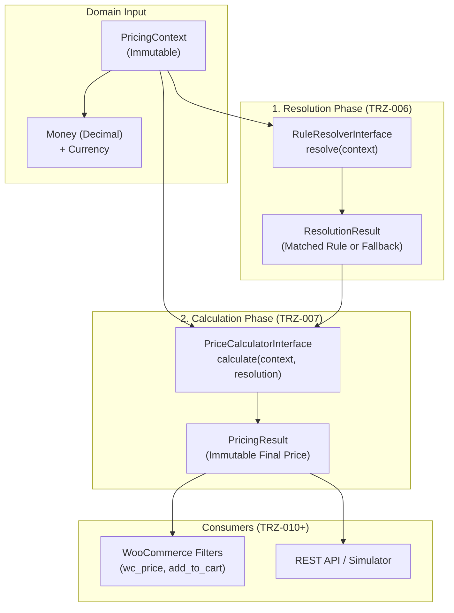

# Tierza — Pricing Contracts & Domain Interfaces (TRZ-005)

**Document Version:** 1.0.0  
**Status:** Approved Specification  
**Namespace:** `Tierza\Domain\Pricing`  
**License:** GPL-2.0-or-later

---

## 1. Overview and Objective

The pricing engine in Tierza is designed around deterministic, testable, and isolated domain contracts. The domain layer remains strictly agnostic of WordPress and WooCommerce globals (such as `get_current_user_id()`, `WC()->cart`, or database tables), enabling 100% pure unit testing and isolated evaluation.

TRZ-005 establishes the authoritative types, value objects, and interfaces that govern:
1. **Context Representation**: `PricingContext`
2. **Deterministic Arithmetic**: `Money` and `DecimalMath`
3. **Rule Resolution Contracts**: `RuleResolverInterface` and `ResolutionResult`
4. **Authoritative Calculation Contracts**: `PriceCalculatorInterface` and `PricingResult`
5. **Precedence Hierarchy & Machine-Readable Audit Codes**: `PrecedenceLevel`, `PricingSource`, and `PricingReasonCode`

These contracts serve as the baseline for:
- **TRZ-006**: Rule Resolver
- **TRZ-007**: Price Calculator
- **TRZ-008**: Pricing Engine Unit Test Matrix
- **TRZ-009**: Multi-level High-Performance Pricing Cache
- **TRZ-010 to TRZ-013**: WooCommerce Integrations (Product, Cart, Order, Admin)

---

## 2. Object Relationships & Architecture



---

## 3. Money and Decimal Precision Strategy

### 3.1 Binary Floating-Point Imprecision Prevention
IEEE-754 binary floating-point arithmetic (native PHP `float`) is explicitly rejected for authoritative price calculation. Binary floats introduce well-known rounding anomalies (e.g., `0.1 + 0.2 = 0.30000000000000004`), which lead to off-by-one errors in invoice calculations, cart totals, and tax reporting.

### 3.2 Arbitrary-Precision String Decimal Arithmetic
- All monetary operations use fixed-scale decimal strings (`numeric-string`).
- **Internal Scale**: 6 decimal places (`0.000000`), matching database storage `DECIMAL(20,6)`.
- **Rounding Mode**: `PHP_ROUND_HALF_UP` (standard financial and e-commerce convention).
- **Format / Display**: Clean formatting to 2, 4, or store-configured decimals without floating-point conversion.

### 3.3 Shared Hosting and BCMath Evaluation
- On production environments with `ext-bcmath` enabled, `DecimalMath` leverages native C-level routines (`bcadd`, `bcsub`, `bcmul`, `bcdiv`, `bccomp`) for optimal execution speed.
- In minimal shared hosting environments where `bcmath` is omitted, `DecimalMath` provides an algorithmic pure-PHP string arithmetic fallback.
- **Result**: Tierza introduces zero undocumented mandatory PHP extensions and guarantees 100% identical arithmetic behavior regardless of host configuration.

### 3.4 Multi-Currency and Explicit Store Currency
- Every `Money` instance is bound to an explicit currency code (e.g. `'USD'`, `'EUR'`, `'IRR'`, `'IRT'`).
- **Zero Automatic Conversion**: Tierza strictly does **not** assume or perform automatic currency conversions (e.g. 1 Toman = 10 Rials). The store's active currency is authoritative.
- Operations across different currencies trigger a domain `CurrencyMismatchException`.

---

## 4. Rule Precedence Specification

Tierza v1 enforces a strict 9-level precedence hierarchy. Rules do **not** stack in v1; exactly one winning rule (or the fallback) applies.

| Precedence | Level Identifier | Description | Source |
| :---: | :--- | :--- | :--- |
| **1** | `CUSTOMER_VARIATION` | Customer-specific rule applied to a product variation | `customer` |
| **2** | `CUSTOMER_PRODUCT` | Customer-specific rule applied to a specific product | `customer` |
| **3** | `CUSTOMER_CATEGORY` | Customer-specific rule applied to a product category | `customer` |
| **4** | `CUSTOMER_GLOBAL` | Customer-specific storewide rule | `customer` |
| **5** | `GROUP_VARIATION` | Group-specific rule applied to a product variation | `group` |
| **6** | `GROUP_PRODUCT` | Group-specific rule applied to a specific product | `group` |
| **7** | `GROUP_CATEGORY` | Group-specific rule applied to a product category | `group` |
| **8** | `GROUP_GLOBAL` | Group-specific storewide rule | `group` |
| **9** | `WOOCOMMERCE_FALLBACK` | Default WooCommerce base / catalog price | `woocommerce` |

### 4.1 Category Hierarchy Tie-Breaking
When a product belongs to multiple categories or a category tree:
1. **Hierarchy Depth**: A rule on a deeper (child) category takes precedence over an ancestor (parent) category.
2. **Deterministic Sibling Tie-Break**: If multiple matching categories share the same hierarchy depth, the conflict is deterministically resolved by lowest category ID (`category_id ASC`). Conflicting rules are never chosen randomly.

### 4.2 Explicit 0% Rules vs. Missing Rules
- An active rule with a 0% discount is valid and authoritative. If a customer has a 0% product rule (Level 2), it overrides any group-level discount (e.g., a 20% group rule at Level 6).
- `ResolutionResult::has_rule()` returns `true` for a 0% rule, with reason code `RULE_APPLIED_ZERO_PERCENTAGE`.
- Missing rules evaluate to `PrecedenceLevel::WOOCOMMERCE_FALLBACK` with `has_rule() === false`.

---

## 5. Type Definitions and Contract Interfaces

### 5.1 `PricingContext`
```php
final class PricingContext {
    public function __construct(
        int $product_id,
        Money $base_price,
        int $customer_id = 0,
        ?PricingGroup $group = null,
        ?int $variation_id = null,
        array $category_ids = [],
        array $category_depths = [],
        ?Money $regular_price = null,
        ?Money $sale_price = null,
        int $quantity = 1,
        ?int $group_id = null
    );
}
```

### 5.2 `RuleResolverInterface`
```php
namespace Tierza\Domain\Pricing\Contracts;

interface RuleResolverInterface {
    public function resolve( PricingContext $context ): ResolutionResult;
}
```

### 5.3 `PriceCalculatorInterface`
```php
namespace Tierza\Domain\Pricing\Contracts;

interface PriceCalculatorInterface {
    public function calculate( PricingContext $context, ResolutionResult $resolution ): PricingResult;
}
```

### 5.4 `PricingResult` Payload
```json
{
  "original_price": "100.000000",
  "final_price": "85.000000",
  "currency": "USD",
  "applied_rule_id": 42,
  "pricing_type": "percentage",
  "scope_type": "product",
  "source": "customer",
  "is_rule_applied": true,
  "is_zero_percentage": false,
  "is_discounted": true,
  "discount_amount": "15.000000",
  "savings_percentage": "15.000000",
  "reason_code": "RULE_APPLIED_CUSTOMER_PRODUCT"
}
```

---

## 6. Error Handling & Edge Cases

| Exception Class | Trigger Condition | Recoverable / Action |
| :--- | :--- | :--- |
| `InvalidMoneyException` | Negative price, non-numeric string, negative multiplier | Fatal for calculation. Prevents free product vulnerability. |
| `CurrencyMismatchException` | Mixing different currencies during calculation or in context | Fatal. Halt and log configuration error. |
| `InvalidPricingContextException` | `product_id <= 0`, `customer_id < 0`, `quantity < 1` | Fatal. Calling hook must provide valid entity references. |
| `InvalidProductVariationException` | `variation_id <= 0` or `variation_id === product_id` | Fatal. Inconsistent WooCommerce variation structure. |
| `MissingBasePriceException` | Product has no active price in WooCommerce | Recoverable fallback to standard WooCommerce display logic. |
| `RuleResolutionException` | Corrupted rule repository state or invalid resolution state | Logged; falls back safely to original WooCommerce price. |

---

## 7. Next Task Boundaries

- **TRZ-006 (Rule Resolver)**: Implements `RuleResolverInterface`, building candidate priority queues and category hierarchy evaluation algorithms.
- **TRZ-007 (Price Calculator)**: Implements `PriceCalculatorInterface`, clamping discounts, supporting fixed prices on products/variations, and formatting to WooCommerce decimals.
- **TRZ-008 (Unit Testing Matrix)**: Comprehensive boundary test suite for all combinations of rules, tiers, and currencies.
