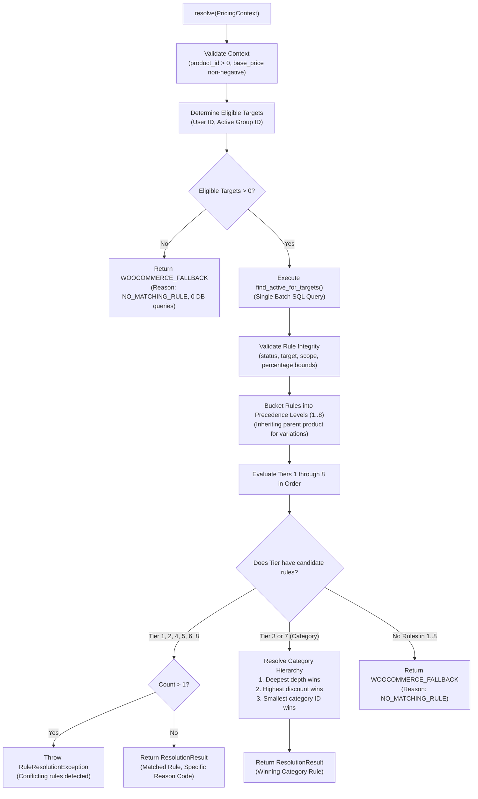

# Tierza — Deterministic Rule Resolver (TRZ-006)

**Document Version:** 1.0.0  
**Status:** Approved Specification  
**Namespace:** `Tierza\Application\Pricing`  
**License:** GPL-2.0-or-later

---

## 1. Overview and Objective

The `DeterministicRuleResolver` is the core pricing rule selection engine for Tierza. It evaluates an immutable `PricingContext` (containing product, customer, group, and category data) and deterministically selects exactly **one** winning pricing rule from the repository, or returns an explicit fallback result when no applicable rule exists.

In accordance with Tierza Product Requirements Document (PRD v1), rule resolution is completely decoupled from price calculation. The resolver's sole responsibility is identifying *which rule applies* based on the strict 9-level precedence hierarchy and tie-breaking policies. Price evaluation (discounts, fixed prices, min/max limits, rounding) is deferred to the calculation engine in TRZ-007.

Key architectural characteristics:
- **Zero Floating-Point Operations**: Preserves domain purity and exact numerical guarantees.
- **Single Batch Query Optimization**: Executes at most 1 database query for authenticated users and 0 queries for anonymous users without groups.
- **Pure Dependency Injection**: Operates on `RuleRepositoryInterface` and `GroupRepositoryInterface`, requiring no WordPress or WooCommerce runtime during evaluation.
- **100% Deterministic**: Identical inputs always produce the identical winning rule regardless of database row order or retrieval sequence.
- **Defensive Safeguards**: Detects corrupted data, negative amounts, out-of-bounds percentages, and missing category depths with explicit domain exceptions.

---

## 2. Precedence Hierarchy

Tierza v1 implements a strict, deterministic 9-level precedence hierarchy without rule stacking or compounding:

| Priority | Precedence Level | Target Type | Scope Type | Scope Target | Description |
|:---:|:---|:---:|:---:|:---:|:---|
| **1** | `CUSTOMER_VARIATION` | Customer (`user`) | `variation` | Specific Variation ID | Rule created for a specific user on a specific product variation. |
| **2** | `CUSTOMER_PRODUCT` | Customer (`user`) | `product` | Product ID | Rule created for a specific user on a product (or variation's parent product). |
| **3** | `CUSTOMER_CATEGORY` | Customer (`user`) | `category` | Product Category ID | Rule created for a specific user on a product's assigned category. |
| **4** | `CUSTOMER_GLOBAL` | Customer (`user`) | `global` | All Store Products (0) | Storewide rule created for a specific user. |
| **5** | `GROUP_VARIATION` | Group (`group`) | `variation` | Specific Variation ID | Rule created for a customer's group on a specific variation. |
| **6** | `GROUP_PRODUCT` | Group (`group`) | `product` | Product ID | Rule created for a customer's group on a product (or parent product). |
| **7** | `GROUP_CATEGORY` | Group (`group`) | `category` | Product Category ID | Rule created for a customer's group on a product's category. |
| **8** | `GROUP_GLOBAL` | Group (`group`) | `global` | All Store Products (0) | Storewide rule created for a customer's group. |
| **9** | `WOOCOMMERCE_FALLBACK` | None | None | None | Standard WooCommerce base price applies (no B2B rule matches). |

### Strict Precedence Invariants:
1. **Higher Level Always Wins**: A rule at Priority 1 always beats Priority 2..9, regardless of discount depth or pricing value.
2. **Customer Overrides Group**: Customer rules (1..4) strictly supersede Group rules (5..8).
3. **Specific Scope Overrides Broad Scope**: Variation overrides Product, which overrides Category, which overrides Global.
4. **No Stacking in v1**: Exactly one rule wins. Rules are never combined or compounded.
5. **Fallback Default**: If no active rule matches in priorities 1..8, priority 9 (`WOOCOMMERCE_FALLBACK`) is returned with reason `NO_MATCHING_RULE`.

---

## 3. Resolution Sequence & Workflow



---

## 4. Category Hierarchy Tie-Breaking Policy

When multiple category rules match at Level 3 (`CUSTOMER_CATEGORY`) or Level 7 (`GROUP_CATEGORY`), Tierza applies a deterministic 3-step tie-breaking procedure:

1. **Step 1 — Greatest Hierarchy Depth**:
   Rules assigned to deeper child categories in the taxonomy tree take precedence over broader ancestor categories.
   - Example: Rule on Category *Laptops* (depth 3) defeats Rule on Category *Electronics* (depth 1).
   - If category depth metadata is missing from the context, a `RuleResolutionException` is immediately thrown to prevent undefined non-deterministic resolution.
2. **Step 2 — Highest Percentage Discount (Lowest Final Price)**:
   If two candidate category rules reside at the exact same depth level, the rule offering the greatest percentage discount (lowest final price for the B2B customer) wins.
   - Example: 25% discount on *Casual Shirts* (depth 2) defeats 15% discount on *Summer Apparel* (depth 2).
3. **Step 3 — Smallest Category ID (`category_id ASC`)**:
   If both category rules reside at identical depth and offer the identical discount percentage, the category with the lower numeric taxonomy term ID wins.
   - Example: Category ID 42 wins over Category ID 88.
4. **Duplicate Prevention**: If multiple active rules target the *same* category ID at the same precedence level, a `RuleResolutionException` is thrown.

---

## 5. Single-Query Database Optimization

To support high-traffic WooCommerce stores, `DeterministicRuleResolver` minimizes database load:

### 5.1 Batch Query Signature
```php
RuleRepositoryInterface::find_active_for_targets( array $targets ): array
```

### 5.2 SQL Execution
Instead of issuing individual queries per level, `WpRuleRepository::find_active_for_targets()` builds an indexed composite query matching all eligible targets in a single trip:
```sql
SELECT * FROM wp_tierza_rules
WHERE (
    (target_type = 'user' AND target_id = 42)
    OR
    (target_type = 'group' AND target_id = 7)
)
AND status = 'active';
```
- Utilizes composite index `idx_target (target_type, target_id, status)` for instant lookup.
- Returns all candidate rules for both customer and group simultaneously.

### 5.3 Query Count Guarantees
- **Anonymous Users without Group**: **0 DB queries**. Target list is empty, repository is never invoked.
- **Authenticated Users / Group Members**: **Exactly 1 DB query**. Single batch query retrieves all applicable rules.
- Memory bucketing and precedence sorting happen entirely in-memory in `O(N)` time where `N` is the small set of active rules for the customer/group (typically 1 to 10 records).

---

## 6. Critical Invariants & Defensive Handling

### 6.1 Explicit 0% Discount & 0.00 Fixed Price
An active rule offering `0.000000%` discount or `$0.000000` fixed price is a completely valid business rule (e.g. explicitly exempting a VIP customer from discounts or granting free promotional items).
- Resolves to `PrecedenceLevel::CUSTOMER_*` or `PrecedenceLevel::GROUP_*`.
- Emits `PricingReasonCode::RULE_APPLIED_ZERO_PERCENTAGE` for explicit 0% rules, allowing downstream systems and logs to distinguish intended zero discounts from unconfigured fallbacks.

### 6.2 Inactive Rules and Inactive Groups
- Inactive rules (`status = 'inactive'`) are filtered out by the repository query and validated again in application memory. They never win.
- Inactive groups (`status = 'inactive'`) are completely ignored during target collection. Customers belonging to an inactive group receive only customer-specific rules (1..4) or fallback (9). Group rules (5..8) are excluded.
- If a context references a group ID that does not exist in the repository (e.g. deleted group), the resolver defensively throws `RuleResolutionException` rather than silently ignoring referential corruption.

### 6.3 Anonymous Customers
Guests and unauthenticated visitors (`customer_id = 0`) never receive customer-specific rules. If no group is assigned, the resolver immediately returns `WOOCOMMERCE_FALLBACK` without querying the database.

### 6.4 Parent Product Inheritance for Variations
For variable products, if no variation-specific rule exists (Tiers 1 & 5), the resolver allows the variation to match parent product rules at Tiers 2 (`CUSTOMER_PRODUCT`) and 6 (`GROUP_PRODUCT`).
- Customer product rule (Tier 2) beats Group variation rule (Tier 5).
- Group product rule (Tier 6) applies only if no customer rules (1..4) or group variation rules (5) match.

---

## 7. Concrete Examples

### 7.1 Simple Product
- **Context**: Product ID `101`, Base Price `$100.00`, Customer ID `5`, Group `VIP` (ID `2`), Category `Smartphones` (ID `30`, depth 2).
- **Rules Stored**:
  - Rule A: Group `VIP` on Category `Smartphones` (20% off).
  - Rule B: Customer `5` Global (10% off).
- **Evaluation**:
  - Rule B matches Level 4 (`CUSTOMER_GLOBAL`).
  - Rule A matches Level 7 (`GROUP_CATEGORY`).
  - Precedence Level 4 beats Level 7.
- **Winner**: Rule B (`CUSTOMER_GLOBAL`, 10% off). Reason: `RULE_APPLIED_CUSTOMER_GLOBAL`.

### 7.2 Variable Product (Variation Inheritance)
- **Context**: Parent Product ID `200`, Variation ID `201`, Base Price `$50.00`, Customer ID `8`, Group `Wholesale` (ID `3`).
- **Rules Stored**:
  - Rule X: Group `Wholesale` on Product `200` (15% off).
  - Rule Y: Customer `8` on Variation `201` (25% off).
- **Evaluation**:
  - Rule Y matches Level 1 (`CUSTOMER_VARIATION`).
  - Rule X matches Level 6 (`GROUP_PRODUCT`).
  - Precedence Level 1 beats Level 6.
- **Winner**: Rule Y (`CUSTOMER_VARIATION`, 25% off). Reason: `RULE_APPLIED_CUSTOMER_VARIATION`.

---

## 8. Verification Matrix

The deterministic rule resolver is verified by:
1. **53 Isolated Unit Tests** (`DeterministicRuleResolverTest`):
   - All 8 precedence tiers tested individually.
   - Customer vs. Group precedence tests.
   - Variation vs. Product precedence tests.
   - Category depth, discount, and ID tie-breaking tests.
   - Explicit 0% and 0.00 fixed price tests.
   - Inactive rule and inactive group tests.
   - Missing metadata and data corruption exception tests.
   - 50-iteration randomized rule array ordering test (confirming 100% deterministic result regardless of input order).
   - Complete 28-pair precedence matrix test comparing every higher-priority tier against every lower-priority tier.
2. **4 Live MariaDB Integration Tests** (`DatabaseIntegrationLiveTest`):
   - Real database stored rules resolution.
   - Real MariaDB category taxonomy hierarchy resolution.
   - Real MariaDB explicit 0% and inactive rules filtering.
   - Real MariaDB query count assertions (0 queries for anonymous, 1 batch query for authenticated).
