# Tierza Architecture — WooCommerce Blocks & Store API Pricing Integration (TRZ-012)

## 1. Architectural Overview & Design Invariants

**TRZ-012 extends Tierza's authoritative pricing engine to modern Gutenberg Cart & Checkout Blocks powered by the WooCommerce Store API (`/wp-json/wc/store/v1/`).**

Classic WooCommerce relies on template rendering and form posts (`woocommerce_after_checkout_validation`), while WooCommerce Blocks rely entirely on headless REST architecture and JavaScript client rendering via `@woocommerce/blocks-checkout` and `@woocommerce/price-format`.

TRZ-012 ensures that negotiated B2B prices, quantity tier scales, variation-level rules, and user group discounts are reflected with complete determinism, minor-unit accuracy, and strict security across all Store API endpoints and block components.

### Core Architectural Invariants:
1. **Single Authoritative Domain Engine:** TRZ-012 reuses the core pricing domain engine (`DeterministicRuleResolver`, `AuthoritativePriceCalculator`, `RequestPricingCache`, `PricingBatchPrefetcher`, `PricingFailureTracker`, and `CartPricingAdapter`). No parallel or divergent calculation logic exists.
2. **Zero Database Mutation:** Catalog prices in `wp_posts` and `wp_postmeta` are never altered during Store API cart calculations or draft order creation.
3. **Fail-Closed Security Boundary:** Any unresolved pricing calculation error, database read failure, or price discrepancy at checkout boundary halts order creation and payment processing immediately with an HTTP 400/409 `RouteException` or `InvalidCartException`.
4. **No Sensitive Information Disclosure:** Public Store API error responses only expose generic, translated shopper error messages and machine-readable error codes (`tierza_store_api_checkout_pricing_error`). Raw SQL errors, paths, credentials, and stack traces are strictly prohibited from REST responses and action payloads.
5. **Minor Units & Tax Consistency:** Store API formats currency values in minor units (`8000` for `$80.00`) and standard decimal representations (`"80.00"`). Tierza maintains exact mathematical alignment between `prices->price`, `totals->line_total`, and persisted WooCommerce order item amounts.
6. **100% Backward Compatibility:** Classic cart and checkout flows (TRZ-011) remain completely unaffected and functional side-by-side with modern Blocks.

---

## 2. Store API Lifecycle & Hook Integration

WooCommerce Store API executes cart calculation and checkout validation across distinct controller hooks that differ fundamentally from the classic WooCommerce checkout lifecycle:

```mermaid
flowchart TD
    subgraph StoreApiCartLifecycle["Store API Cart Lifecycle (/wp-json/wc/store/v1/cart)"]
        A[Cart Block Loads / Updates / Adds Item] --> B[CartController::calculate_totals]
        B --> C[woocommerce_before_calculate_totals]
        C --> D[CartPricingIntegration::on_before_calculate_totals]
        D --> E[CartPricingAdapter::prefetch_cart & apply_cart_item_pricing]
        E --> F[WC_Cart Items Receive Tierza Authoritative Price]
        F --> G[StoreApi CartItemSchema Formats Minor Units]
        G --> H[JSON Response Delivered to Gutenberg Block]
    end

    subgraph StoreApiCheckoutValidation["Store API Checkout Boundary (/wp-json/wc/store/v1/checkout)"]
        I[Customer Clicks Place Order in Checkout Block] --> J[CartController::validate_cart]
        J --> K[woocommerce_store_api_cart_errors]
        K --> L{PricingFailureTracker has failures?}
        L -- Yes --> M[Add WP_Error -> Store API throws InvalidCartException 409]
        L -- No --> N[Draft Order Creation: create_or_update_draft_order]
        N --> O[woocommerce_store_api_checkout_update_order_meta]
        O --> P[CartPricingAdapter::revalidate_checkout]
        P --> Q{Revalidation Passed?}
        Q -- Discrepancy / Error --> R[Throw RouteException 400 -> Block Order]
        Q -- Clean --> S[Draft Order Meta Updated]
        S --> T[woocommerce_store_api_checkout_order_processed]
        T --> U{Final Integrity Gate}
        U -- Failed --> V[Throw RouteException 400 -> Block Payment Gateway]
        U -- Clean --> W[Execute Gateway Payment & Confirm Order]
    end
```



### Store API Hook Map:
| Hook Name | Priority | Purpose |
|---|---|---|
| `woocommerce_before_calculate_totals` | 10 | Triggered by `CartController::calculate_totals()`. Applies Tierza pricing and attaches `tierza_pricing` item metadata. |
| `woocommerce_store_api_cart_errors` | 10 | Evaluates `PricingFailureTracker` and cart item integrity during `CartController::validate_cart()`. Adding a `WP_Error` triggers `InvalidCartException` (HTTP 409). |
| `woocommerce_store_api_checkout_update_order_meta` | 10 | Runs inside `create_or_update_draft_order()`. Performs authoritative revalidation against live rules and draft order line items. Throws `RouteException` (HTTP 400) on failure. |
| `woocommerce_store_api_checkout_order_processed` | 10 | Final pre-payment barrier. Verifies that order totals match revalidated pricing before payment gateway execution. |

---

## 3. Error Classification & Information Disclosure Prevention

Store API public responses are visible to frontend client browsers and mobile applications. To prevent diagnostic leakage:

1. **Shopper-Facing Messages:**
   - Always translated using WordPress standard i18n (`__( '...', 'tierza' )`).
   - Generic guidance: `"Your cart pricing could not be verified. Please review your cart and try again."`
2. **Internal Diagnostic Logging:**
   - Logged strictly through `CartPricingAdapter::log_error()`.
   - Internal credentials, database queries, and stack traces are redacted.
3. **Structured Public Actions:**
   - Action `tierza_store_api_checkout_pricing_validation_failed` emits only sanitized data:
     ```php
     do_action(
         'tierza_store_api_checkout_pricing_validation_failed',
         $order,
         $code,
         $safe_message,
         $sanitized_failures
     );
     ```

---

## 4. Performance & Scalability

Benchmarking under live MariaDB workloads confirms near-linear scaling and low latency overhead for Store API requests:

| Cart Size | Store API Response Time | Per-Item Processing Time | Peak Memory | SQL Rule Queries |
|---|---|---|---|---|
| **1 item** | ~4.34 ms | 4.34 ms/item | 105.00 MB | 1 (Prefetched) |
| **10 items** | ~7.54 ms | 0.75 ms/item | 105.13 MB | 1 (Prefetched) |
| **50 items** | ~22.62 ms | 0.45 ms/item | 105.99 MB | 1 (Prefetched) |
| **100 items** | ~31.37 ms | 0.31 ms/item | 107.23 MB | 1 (Prefetched) |

All product and variation pricing rules are batched via `PricingBatchPrefetcher` in a single SQL query, avoiding $O(N)$ database query spikes.
