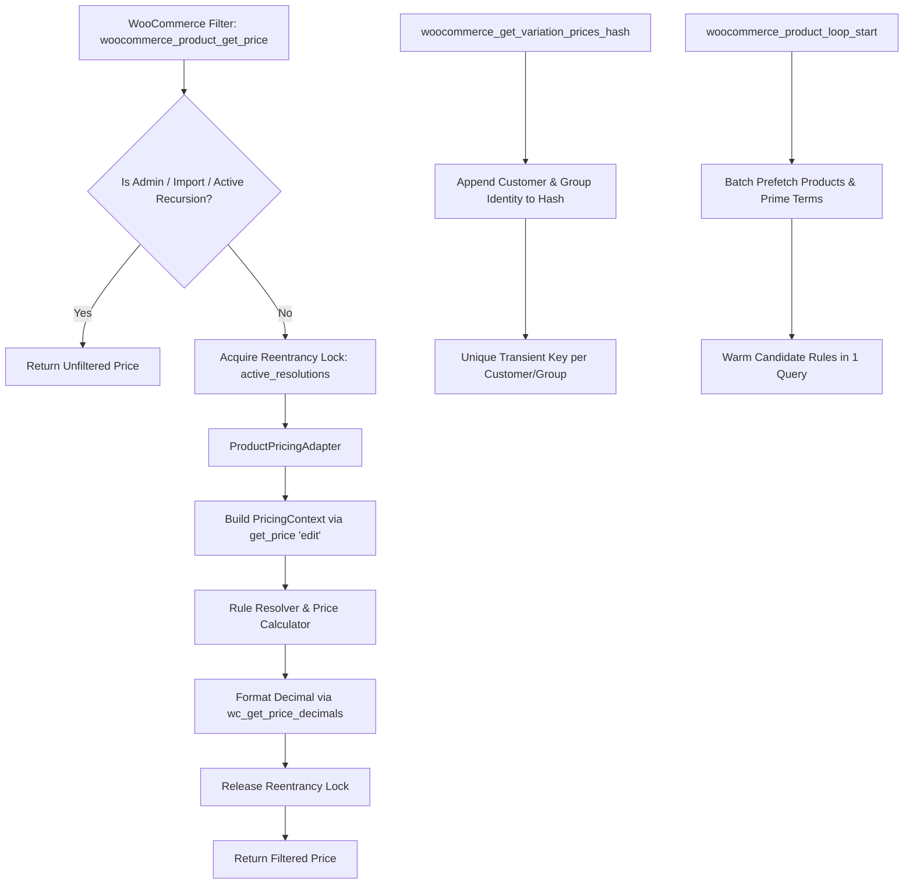

# Tierza Architecture — WooCommerce Product Pricing Integration (TRZ-010)

## 1. Overview & Objective

**TRZ-010 connects Tierza's authoritative pricing engine directly with WooCommerce product price retrieval, archive loops, single product views, and variation calculation.**

Before TRZ-010, Tierza's deterministic rule resolver, authoritative price calculator, and multi-tier pricing cache operated as an independent domain engine. TRZ-010 establishes seamless, safe, and high-performance integration into WooCommerce's pricing pipeline while preserving core design invariants:
- **Zero Database Pollution:** Original WooCommerce prices (`_price`, `_regular_price`, `_sale_price`) stored in `wp_posts` and `wp_postmeta` are never modified.
- **Unfiltered Original Price Acquisition:** Always reads raw data via `$product->get_price('edit')`, `$product->get_regular_price('edit')`, and `$product->get_sale_price('edit')` without triggering filter loops.
- **Recursion & Reentrancy Guards:** Dual-layer guard (`$active_resolutions` stack lock) prevents infinite loops if WooCommerce or third-party plugins call `$product->get_price()` internally during filtering.
- **Native Promotional Sale Awareness:** Distinguishes active scheduled WooCommerce sales from normal regular prices. If an active native sale price is ongoing, Tierza treats it as the authoritative baseline discount target; no sale is inferred solely from numerical equality.
- **Variation Cache Isolation:** Segregates WooCommerce's internal transient variation price cache (`wc_var_prices_{$id}`) per customer and group via `woocommerce_get_variation_prices_hash`.
- **Batch Prefetching in Catalog Listings:** Automatically primes taxonomy terms and prefetches candidate rules in archive loops via `woocommerce_product_loop_start` and `the_posts`, eliminating N+1 queries.
- **Scope Guards:** Protects admin edit screens (`post.php`, `post-new.php`, `edit.php`, `woocommerce_save_variations`), CSV import/export, and administrative REST requests from accidental price manipulation.

---

## 2. Integration Pipeline Architecture



---

## 3. Core Components

### 3.1. `ProductPricingAdapter` (`src/Integration/WooCommerce/ProductPricingAdapter.php`)
Acts as the authoritative bridge between WooCommerce entity models and Tierza domain contracts:
1. **Context Construction (`get_pricing_context`):**
   - Extracts base price, regular price, and sale price using context parameter `'edit'` (`$product->get_price('edit')`).
   - Determines active native sale status using strict date checks (`get_date_on_sale_from('edit')`, `get_date_on_sale_to('edit')`).
   - Traverses product category taxonomy (`product_cat`) and calculates category depth hierarchy via `get_ancestors()`.
   - Resolves customer identity securely via WordPress authentication state (`get_current_user_id()`), never trusting query parameters.
   - Resolves customer group assignment with runtime in-memory caching.
2. **Price Formatting (`get_price` / `get_adjusted_price`):**
   - Formats final calculated money amounts using store currency decimals (`wc_get_price_decimals()`).
   - Preserves unpriced and invalid products without modification.
3. **HTML Formatting (`get_price_html`):**
   - Formats standard WooCommerce price HTML (`<del>regular</del> <ins>final</ins>`) without leaking sensitive rule internal diagnostics.
4. **Batch Prefetching (`prefetch_products`):**
   - Primes taxonomy term caches via `update_object_term_cache()`.
   - Assembles `PricingContext` objects for all products (including variable children) and warms candidate rules in 1 SQL query.

### 3.2. `ProductPricingIntegration` (`src/Integration/WooCommerce/ProductPricingIntegration.php`)
Registers and manages all WooCommerce WordPress hooks with strict safety boundaries:
- `woocommerce_product_get_price`: Filters simple and base product prices.
- `woocommerce_product_variation_get_price`: Filters individual variation prices.
- `woocommerce_variation_prices_price`: Filters variation array prices used for min/max ranges.
- `woocommerce_get_variation_prices_hash`: Appends customer and group data to transient cache keys.
- `woocommerce_get_price_html`: Filters display price HTML with strikethrough styling.
- `woocommerce_product_loop_start` & `the_posts`: Triggers catalog batch prefetching.

---

## 4. Security & Isolation Guarantees

### Customer Identity Verification
Customer identity is strictly derived from verified WordPress session authentication in production storefront requests. Explicit customer overrides are strictly restricted to authorized administrators (`manage_woocommerce`) or isolated test environments (`can_override_customer_identity()`):
```php
public function resolve_customer_id( ?int $explicit_id = null ): int {
    if ( $this->test_mode ) {
        if ( null !== $this->test_customer_id ) {
            return max( 0, $this->test_customer_id );
        }
        if ( null !== $explicit_id ) {
            return max( 0, $explicit_id );
        }
    }

    // Security boundary: in production storefront execution, strictly derive from authenticated WordPress session.
    if ( function_exists( 'get_current_user_id' ) ) {
        return (int) get_current_user_id();
    }

    return 0;
}
```
Query parameters, headers, or client requests are never trusted to impersonate customer groups. Even logged-in administrators browsing the storefront have their prices resolved for their own user account, completely ignoring any passed customer ID parameter. Administrative simulation is decoupled and managed exclusively via `AdminPricingSimulationService` with explicit capability checks (`manage_woocommerce`).

### Variation Cache Segregation & Invalidation Under Persistent Object Caches
WooCommerce variable products cache price ranges in transients using `wc_var_prices_{$product_id}`.
Tierza ensures zero cross-customer leakage and immediate invalidation across mutations via `VariationPriceCacheInvalidator`:
1. **Concurrency-Safe Atomic Monotonic Versioning:**
   - Invalidation executes an atomic upsert `INSERT INTO wp_options (option_name, option_value, autoload) VALUES ('tierza_var_price_version', '2', 'no') ON DUPLICATE KEY UPDATE option_value = CAST(COALESCE(NULLIF(option_value, ''), '1') AS UNSIGNED) + 1`.
   - Row-level locking on `UNIQUE KEY option_name` prevents lost updates when multiple administrators save rules concurrently.
   - Database write failures throw `DatabaseQueryException` and never falsely report success.
   - Cleans WordPress options object cache (`clean_option_cache`, `wp_cache_delete`) to maintain cross-process coherence.
2. **Transient Hash Segregation (`woocommerce_get_variation_prices_hash`):**
   - Appends customer ID, group ID, active status, and the current atomic `tierza_version` to the transient hash.
   - Because the hash key changes monotonically, all variation price ranges across Redis, Memcached, APCu, or database transients are instantly and logically invalidated on the next request.
3. **Persistent Object Cache & Database Cleanup:**
   - On targeted rule changes (product/variation scope): `clean_product_transient( $product_id )` deletes `wc_var_prices_{$product_id}` transients via supported WordPress API (`delete_transient()` and `wc_delete_product_transients()`). Under Redis/Memcached, `delete_transient` calls `wp_cache_delete()`, purging the cache entry in memory.
   - On broad changes (global rules, category rules, group status changes, customer reassignment): calls `WC_Cache_Helper::get_transient_version( 'product', true )` to increment WooCommerce's product transient group version, invalidating all product transients across Redis/Memcached, while running database garbage collection on `wp_options`.

### Pure-PHP Fallback & Shared Hosting Compatibility
Direct BCMath functions (`bccomp`) have been completely eliminated from the integration adapter and replaced with `DecimalMath::comp()`. Tierza guarantees 100% calculation and rounding fidelity on minimal shared hosting platforms lacking the PHP `ext-bcmath` extension.

### Category Hierarchy Ancestor Inheritance
Products assigned only to child categories automatically traverse their taxonomy tree using `get_ancestors()`:
- Ancestor category IDs (parent, grandparent, etc.) are included in the pricing context.
- Exact taxonomy depths are computed to guarantee that more specific child category rules override parent category rules according to Tierza's 9-level resolution hierarchy.

### Fail-Closed Production Error Handling & Failure Tracking
If an unexpected runtime failure or database exception occurs during price calculation:
- Tierza distinguishes legitimate no-rule fallback (where no Tierza rule matches and standard catalog price applies) from operational/calculation failures.
- Records failures in `PricingFailureTracker` with machine-readable error codes (`TRZ_ERR_CALCULATION_FAILED`, `TRZ_ERR_REPOSITORY_UNAVAILABLE`, `TRZ_ERR_INVALID_CONTEXT`, `TRZ_ERR_UNEXPECTED`).
- Returns the product's original raw price as a degraded storefront fallback so the public shop does not crash or display an invented $0.00 price.
- Crucially, because the failure state is tracked in `PricingFailureTracker`, downstream adapters in TRZ-011 (cart, checkout, order placement) consume this signal to block unauthorized purchase of degraded fallback prices.
- Safe error logging sanitizes messages and strips passwords, database table names, or internal tokens.
- Fires `tierza_pricing_calculation_failed` or `tierza_pricing_html_failed` action hooks with sanitized error codes and messages—never leaking raw `Throwable` / `Exception` objects to public hooks.

---

## 5. Performance Verification (Real MariaDB & E2E)

### Catalog Loop Query Benchmark
In live MariaDB integration testing with 20 catalog products:
- **Prefetch Phase:** Executes exactly 1 rule query and primes taxonomy term caches.
- **Iteration Loop:** Iterating through all 20 products and calling `$prod->get_price()` executes **0 additional database queries** (`q_loop = 0`).

### Playwright Storefront E2E Suite
Verified against live WordPress 6.5.5 and WooCommerce 8.5.2:
1. **Guest Visitor:** Visits single product page -> sees regular $100.00 price without discount.
2. **Authenticated B2B Customer:** Logs in -> visits single product page -> sees $100.00 struck through (`<del>`) and $75.00 calculated price (`<ins>`).
3. **Incognito Session Isolation:** Opening fresh incognito context reverts cleanly to regular $100.00 price with zero cross-session leakage.
