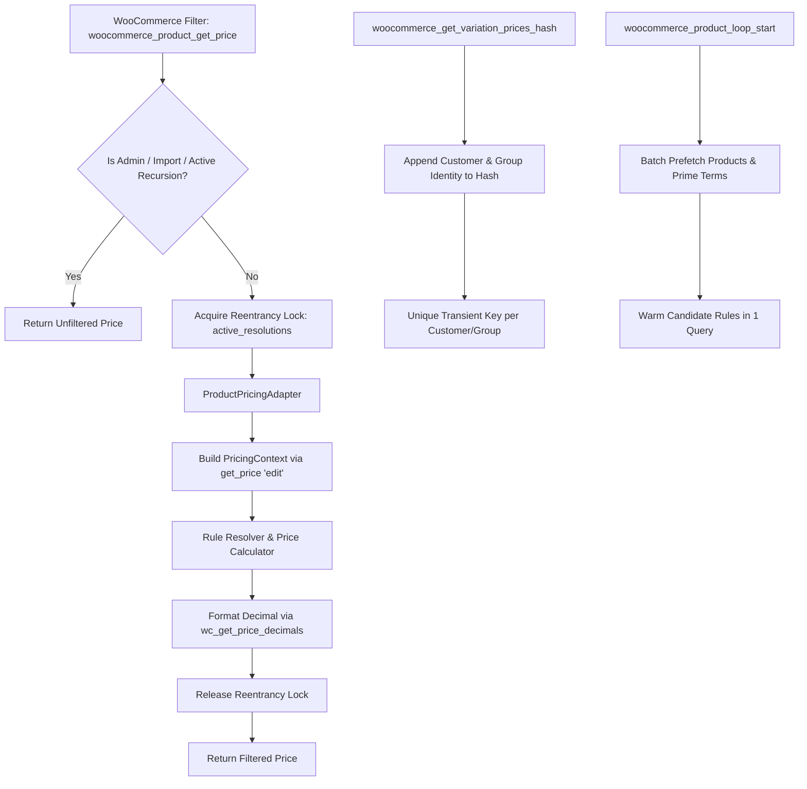

# Tierza Architecture — WooCommerce Product Pricing Integration (TRZ-010)

## 1. Overview & Objective

**TRZ-010 connects Tierza's authoritative pricing engine directly with WooCommerce product price retrieval, archive loops, single product views, and variation calculation.**

Before TRZ-010, Tierza's deterministic rule resolver, authoritative price calculator, and multi-tier pricing cache operated as an independent domain engine. TRZ-010 establishes seamless, safe, and high-performance integration into WooCommerce's pricing pipeline while preserving core design invariants:
- **Zero Database Pollution:** Original WooCommerce prices (`_price`, `_regular_price`, `_sale_price`) stored in `wp_posts` and `wp_postmeta` are never modified.
- **Unfiltered Original Price Acquisition:** Always reads raw data via `$product->get_price('edit')`, `$product->get_regular_price('edit')`, and `$product->get_sale_price('edit')` without triggering filter loops.
- **Recursion & Reentrancy Guards:** Dual-layer guard (`$active_resolutions` stack lock) prevents infinite loops if WooCommerce or third-party plugins call `$product->get_price()` internally during filtering.
- **Native Promotional Sale Awareness:** Distinguishes active scheduled WooCommerce sales from normal regular prices. If an active native sale price is ongoing, Tierza treats it as the authoritative baseline discount target; no sale is inferred solely from numerical equality.
- **Variation Cache Isolation:** Segregates WooCommerce's internal transient variation price cache (`wc_var_prices_{$id}`) per customer and group via `woocommerce_get_variation_prices_hash`.
- **Batch Prefetching in Catalog Listings:** Automatically primes taxonomy terms and prefetches candidate rules in archive loops via `woocommerce_product_loop_start` and `the_posts`, eliminating N+1 queries.
- **Scope Guards:** Protects admin edit screens (`post.php`, `post-new.php`, `edit.php`, `woocommerce_save_variations`), CSV import/export, and administrative REST requests from accidental price manipulation.

---

## 2. Integration Pipeline Architecture



---

## 3. Core Components

### 3.1. `ProductPricingAdapter` (`src/Integration/WooCommerce/ProductPricingAdapter.php`)
Acts as the authoritative bridge between WooCommerce entity models and Tierza domain contracts:
1. **Context Construction (`get_pricing_context`):**
   - Extracts base price, regular price, and sale price using context parameter `'edit'` (`$product->get_price('edit')`).
   - Determines active native sale status using strict date checks (`get_date_on_sale_from('edit')`, `get_date_on_sale_to('edit')`).
   - Traverses product category taxonomy (`product_cat`) and calculates category depth hierarchy via `get_ancestors()`.
   - Resolves customer identity securely via WordPress authentication state (`get_current_user_id()`), never trusting query parameters.
   - Resolves customer group assignment with runtime in-memory caching.
2. **Price Formatting (`get_price` / `get_adjusted_price`):**
   - Formats final calculated money amounts using store currency decimals (`wc_get_price_decimals()`).
   - Preserves unpriced and invalid products without modification.
3. **HTML Formatting (`get_price_html`):**
   - Formats standard WooCommerce price HTML (`<del>regular</del> <ins>final</ins>`) without leaking sensitive rule internal diagnostics.
4. **Batch Prefetching (`prefetch_products`):**
   - Primes taxonomy term caches via `update_object_term_cache()`.
   - Assembles `PricingContext` objects for all products (including variable children) and warms candidate rules in 1 SQL query.

### 3.2. `ProductPricingIntegration` (`src/Integration/WooCommerce/ProductPricingIntegration.php`)
Registers and manages all WooCommerce WordPress hooks with strict safety boundaries:
- `woocommerce_product_get_price`: Filters simple and base product prices.
- `woocommerce_product_variation_get_price`: Filters individual variation prices.
- `woocommerce_variation_prices_price`: Filters variation array prices used for min/max ranges.
- `woocommerce_get_variation_prices_hash`: Appends customer and group data to transient cache keys.
- `woocommerce_get_price_html`: Filters display price HTML with strikethrough styling.
- `woocommerce_product_loop_start` & `the_posts`: Triggers catalog batch prefetching.

---

## 4. Security & Isolation Guarantees

### Customer Identity Verification
Customer identity is strictly derived from verified WordPress session authentication:
```php
public function resolve_customer_id( ?int $explicit_id = null ): int {
    if ( null !== $explicit_id && $explicit_id > 0 ) {
        return $explicit_id;
    }
    if ( function_exists( 'get_current_user_id' ) ) {
        return (int) get_current_user_id();
    }
    return 0;
}
```
Query parameters, headers, or client requests are never trusted to impersonate customer groups.

### Variation Cache Segregation
WooCommerce variable products cache price ranges in WordPress transients using `wc_var_prices_{$product_id}`. Without isolation, Customer A (Wholesale) viewing a product would populate the transient with wholesale prices, which would subsequently be served to guest visitors!

Tierza hooks into `woocommerce_get_variation_prices_hash` to append user-group identity:
```php
add_filter( 'woocommerce_get_variation_prices_hash', [ $this, 'filter_variation_prices_hash' ], 10, 3 );
```
This guarantees separate transient caches for guests, individual customers, and B2B pricing groups.

---

## 5. Performance Verification (Real MariaDB & E2E)

### Catalog Loop Query Benchmark
In live MariaDB integration testing with 20 catalog products:
- **Prefetch Phase:** Executes exactly 1 rule query and primes taxonomy term caches.
- **Iteration Loop:** Iterating through all 20 products and calling `$prod->get_price()` executes **0 additional database queries** (`q_loop = 0`).

### Playwright Storefront E2E Suite
Verified against live WordPress 6.5.5 and WooCommerce 8.5.2:
1. **Guest Visitor:** Visits single product page -> sees regular $100.00 price without discount.
2. **Authenticated B2B Customer:** Logs in -> visits single product page -> sees $100.00 struck through (`<del>`) and $75.00 calculated price (`<ins>`).
3. **Incognito Session Isolation:** Opening fresh incognito context reverts cleanly to regular $100.00 price with zero cross-session leakage.
