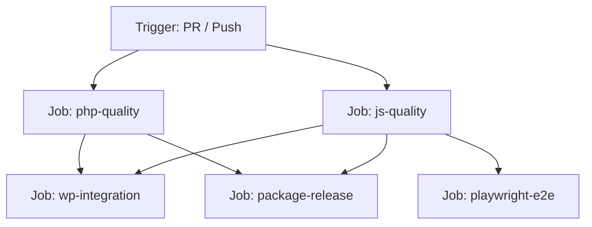

# Tierza — Continuous Integration (CI) Pipeline Guide

This document describes the GitHub Actions CI pipeline architecture, automated test jobs, security constraints, and local troubleshooting workflows for **Tierza**.

---

## 1. Overview & Architecture

The CI pipeline runs automatically on pull requests and pushes to core branches (`main`, `master`).
It guarantees that all code adheres to:
1. **PHP Standards & Static Analysis** (PHP 8.1 minimum & modern PHP 8.4, WordPress Coding Standards, PHPStan Level 8, PHPUnit).
2. **JavaScript & TypeScript Standards** (TypeScript compiler, `@wordpress/scripts` asset compilation, ESLint).
3. **Live WordPress & WooCommerce Integration** (Live Docker execution with WordPress 6.5.5, WooCommerce 8.5.2, Persian RTL validation, lifecycle hooks).
4. **End-to-End Browser Testing** (Playwright automated smoke tests against live WordPress).
5. **Standalone ZIP Package Integrity** (Verification of clean production release archive, isolated from dev dependencies).

---

## 2. Workflow Triggers & Concurrency

Defined in [`.github/workflows/ci.yml`](../.github/workflows/ci.yml):

- **Push Triggers**: Pushes to `main` and `master`.
- **Pull Request Triggers**: PRs targeting `main` and `master`.
- **Manual Trigger**: `workflow_dispatch` allows triggering pipeline runs manually from the GitHub Actions UI.
- **Concurrency**:
  ```yaml
  concurrency:
    group: ${{ github.workflow }}-${{ github.ref }}
    cancel-in-progress: true
  ```
  Automatically cancels obsolete in-flight runs when new commits are pushed to an open pull request.

---

## 3. CI Jobs Breakdown



### Job A: `php-quality`
- **Matrix**: Runs against both PHP `8.1` (minimum required) and PHP `8.4`.
- **Steps**:
  1. `composer install` with dependency caching.
  2. Syntax verification (`php -l` across all PHP files).
  3. `composer phpcs` (WordPress-Core & WordPress-Extra coding standards).
  4. `composer phpstan` (PHPStan strict Level 8 analysis).
  5. `composer test` (PHPUnit unit and mocked integration tests).

### Job B: `js-quality`
- **Runner**: Node.js 20 on Ubuntu.
- **Steps**:
  1. `npm ci` with npm cache.
  2. `npm run type-check` (TypeScript strict check via `tsc --noEmit`).
  3. `npm run lint:js` (ESLint with `@wordpress/eslint-plugin/recommended`).
  4. `npm run build` (Production compilation of assets).
  5. Assertion verifying that `build/index.js` and `build/index.asset.php` were emitted.

### Job C: `wp-integration`
- **Dependency**: Requires `php-quality` and `js-quality`.
- **Environment**: Real Docker container stack using `@wordpress/env` (WordPress 6.5.5, WooCommerce 8.5.2, MariaDB).
- **Verifications**:
  1. Starts containers via `npm run env:start` with healthcheck readiness polling.
  2. Checks plugin active status: `Tierza` and `woocommerce`.
  3. Tests clean deactivation and reactivation.
  4. Tests inactive WooCommerce handling (verifies Tierza does not crash when WooCommerce is disabled).
  5. Installs `fa_IR` language and verifies RTL layout (`is_rtl() === true`) and Persian gettext translation.
  6. Inspects `/var/www/html/wp-content/debug.log` to assert zero PHP fatal errors or Tierza warnings.
  7. Uploads `debug.log` as a build artifact on failure.

### Job D: `playwright-e2e`
- **Dependency**: Requires `js-quality`.
- **Environment**: Real headless Chromium against live `@wordpress/env`.
- **Verifications**:
  1. Installs browser with system dependencies (`npx playwright install --with-deps chromium`).
  2. Executes all 4 E2E smoke tests (`npm run test:e2e`).
  3. Uploads `playwright-report/` and test traces as artifacts on failure or completion.

### Job E: `package-release`
- **Dependency**: Requires `php-quality` and `js-quality`.
- **Verifications**:
  1. Compiles production assets and clean autoloader without dev packages (`composer build:zip`).
  2. Executes standalone extraction runner (`php bin/verify-standalone.php`) in clean isolated temporary environment.
  3. Validates archive structure: single root directory `tierza/`, presence of compiled `.mo` files, and strict exclusion of development fixtures (`tests/`, `.git/`, `phpunit.xml`, `phpstan.neon`).
  4. Uploads installable `dist/tierza.zip` as a workflow artifact.

---

## 4. Workflow Security Standards

- **Minimal Permissions**: The workflow enforces `permissions: contents: read`. No write or administration privileges are granted.
- **No Secrets Exposure**: No deployment credentials, production keys, or privileged tokens are used in the test pipeline.
- **Safe Dependencies**: All actions are sourced from official organizations (`actions/*`, `shivammathur/*`).
- **No Untrusted Execution**: PRs from forks execute in isolated unprivileged runner contexts.
- **No Automatic Deployment**: The CI pipeline strictly validates code quality; releases and production deployments are never published automatically from this pipeline.

---

## 5. Artifact Downloads & Debugging Failures

When a CI run fails, diagnostic artifacts are attached to the GitHub Actions run summary page:
1. **`wp-debug-log`**: Uploaded if `wp-integration` fails, containing the full WordPress debug log.
2. **`playwright-results`**: Uploaded on Playwright failures, containing interactive traces, screenshots, and error context reports.
3. **`tierza-plugin-zip`**: Uploaded on successful completion of `package-release`, containing the installable plugin ZIP archive ready for manual testing.

---

## 6. Local Reproduction Instructions

To reproduce the exact CI checks locally:

```bash
# 1. PHP Quality
composer phpcs
composer phpstan
composer test

# 2. JavaScript Quality
npm run type-check
npm run lint:js
npm run build

# 3. WordPress Integration & E2E (Requires Docker Desktop)
npm run env:start
npm run test:e2e

# 4. Standalone ZIP Packaging
composer build:zip
php bin/verify-standalone.php
```

---

## 7. Recommended Branch Protection Rules

For the primary repository integration branch (`main` / `master`):

1. **Require pull request reviews before merging**:
   - Minimum 1 approving review from core maintainers.
2. **Require status checks to pass before merging**:
   - `PHP Quality (PHP 8.1)`
   - `PHP Quality (PHP 8.4)`
   - `JavaScript & Asset Quality`
   - `Live WordPress & WooCommerce Integration`
   - `Playwright E2E Smoke Tests`
   - `Production ZIP Verification & Packaging`
3. **Require branches to be up to date before merging**.
4. **Do not allow force pushes or branch deletion**.
